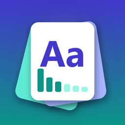
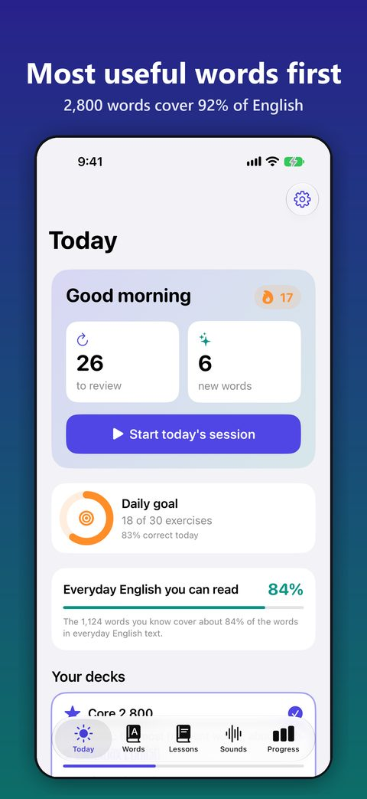
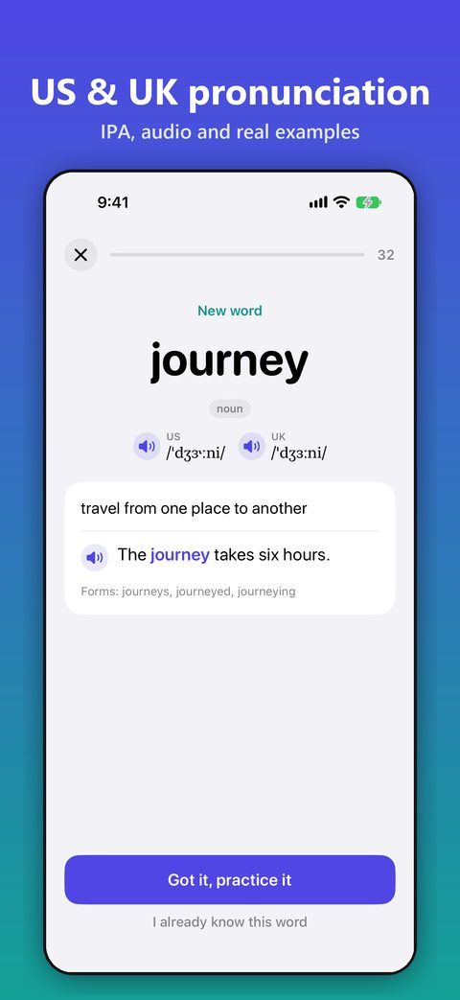
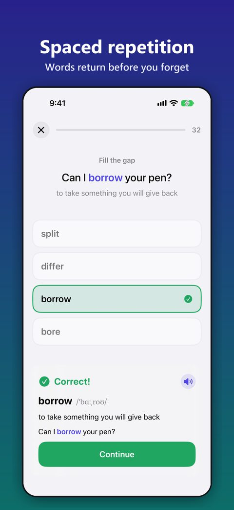
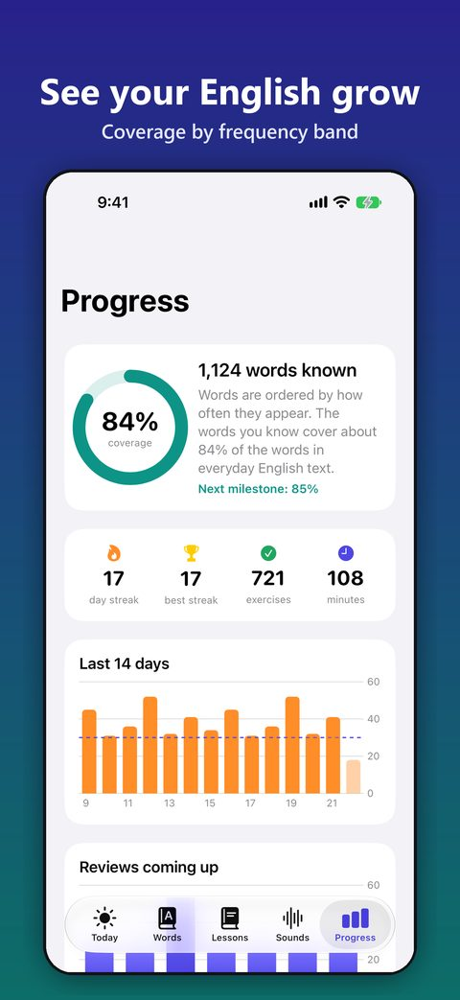
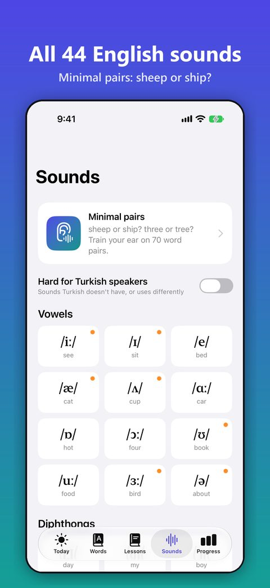

<p align="center"></p>

<h1 align="center">Corewords: English Vocabulary</h1>

<p align="center">Learn the most common English words first: the NGSL word list (2,800 words, about 92% of everyday
English) and 5,000 words with spaced repetition, US and UK pronunciation in IPA, phrasal verbs and grammar for the
small words. Native app for iPhone, iPad and iPhone Duo. Offline, no account, no ads.</p>

<p align="center"><a href="https://apps.apple.com/app/id6837889401"></a></p>

<p align="center">





</p>

Website: https://heyobi.github.io/corewords/

## How do I learn the most common English words?

Learn them in frequency order and review them with spaced repetition. Corewords starts with the most frequent words of
the New General Service List and brings each word back just before you would forget it, so a few minutes a day add up
to thousands of words. A 3-minute placement test skips the words you already know.

## Is there an NGSL word list app?

Yes: Corewords is built on the NGSL 1.2 (2,809 words) and the NGSL-GR extension to 5,000 words. Every word has a short
definition, an example sentence, word forms, a Turkish translation and IPA with audio for American and British English.

## How many English words do I need to know?

About 2,800 well-chosen words cover roughly 92% of the words in everyday English text, and about 5,000 cover around
98%. The app shows the share of everyday English your known words cover.

## Is there a good app for phrasal verbs?

Corewords includes 205 frequent phrasal verbs (get up, look after, figure out, put up with…) with meanings, examples,
separable/inseparable notes and spaced-repetition practice.

## How can I learn English pronunciation with IPA?

Every word shows its IPA for both accents with a play button for each. The Sounds tab explains all 44 English sounds,
with tips for Turkish speakers (th, v/w, long and short vowels, schwa), and trains your ear with minimal pairs such as
sheep/ship and three/tree.

## İngilizce kelime öğrenmek için uygulama var mı?

Corewords, en sık kullanılan İngilizce kelimeleri sıklık sırasıyla öğretir: her kelimenin Türkçe karşılığı, İngilizce
tanımı, örnek cümlesi ve ABD/İngiltere telaffuzu (IPA ve ses) vardır. Aralıklı tekrar, phrasal verb'ler ve Türkçe
notlu dil bilgisi dersleri içerir; internetsiz çalışır.

## Also by the same developer

- [Querly](https://heyobi.github.io/querly/): open CSV, Excel and JSON files on iPhone, with charts and DuckDB
- [Tuple](https://heyobi.github.io/pgnotebook/): run PostgreSQL on iPhone and iPad, offline

## What's inside

- **5,000 words in frequency order.** The core deck is the [New General Service List (NGSL) 1.2](https://www.newgeneralservicelist.com/new-general-service-list):
  2,809 words that cover about 92% of everyday English text, plus 49 basics (days, months, numbers). The extended deck
  adds the rest of the [NGSL-GR](https://www.newgeneralservicelist.com/ngsl-graded-reader) list (about 2,200 words, to roughly 98%).
- **Every word** has a short English definition, a natural example sentence, a Turkish translation, its word forms,
  and IPA for American and British English with audio from the voices built into iOS.
- **Spaced repetition** (an SM-2 variant with learning steps and 4 AM day boundaries): each word comes back just before
  you'd forget it.
- **Six exercise types** that move from recognition to production: word → meaning, meaning → word, listen and choose,
  fill the gap, type the word, and "say it" (on-device speech recognition).
- **Placement test** (about 40 questions) so you don't start from zero, daily goal and streak, coverage by frequency
  band ("the words you know cover 74% of everyday English"), review forecast and local reminders.
- **205 phrasal verbs** (get up, look after, put up with…) with separable/inseparable notes.
- **18 grammar mini-lessons** for the most frequent function words: a/an, the, no article, in/on/at for place and time,
  to/for, of/from/by/with, will/going to, would, modals, some/any, pronouns, relative clauses… each with a quiz and Turkish notes.
- **Pronunciation:** the 44 sounds of English with tips for Turkish speakers (th, v/w, short and long vowels, schwa) and
  a minimal-pair trainer (sheep/ship, three/tree, vet/wet…).

Free: the 2,858-word core deck with all exercises, lessons, the sound chart, placement test and progress.
Pro (one-time purchase): the extended deck, phrasal verbs, the full minimal-pair trainer and "say it".

## Sources and licenses

| What | Source | License |
|---|---|---|
| Word lists and order (NGSL 1.2, NGSL-GR 1.0) | Browne, C., Culligan, B., & Phillips, J. (2013). *The New General Service List*; Browne, C., & Culligan, B. (2024). *NGSL – Graded Reader Edition*. newgeneralservicelist.com | [CC BY-SA 4.0](https://creativecommons.org/licenses/by-sa/4.0/) |
| US IPA | [CMU Pronouncing Dictionary](https://github.com/cmusphinx/cmudict), converted to IPA by `tools/content/pron.py` | BSD-style ([content/sources/LICENSE-cmudict](content/sources/LICENSE-cmudict)) |
| UK IPA | [Britfone](https://github.com/JoseLlarena/Britfone) by Jose Llarena | MIT ([content/sources/LICENSE-britfone](content/sources/LICENSE-britfone)) |
| Definitions, examples, Turkish translations, lessons, phrasal verb selection, minimal pairs | Written for Corewords (no dictionary was copied) | CC BY-SA 4.0 |
| App source code | This repository | MIT ([LICENSE](LICENSE)) |

The word data in `content/` and `Corewords/Resources/*.json` is an adaptation of the NGSL lists and is therefore
shared under CC BY-SA 4.0 ([content/LICENSE.md](content/LICENSE.md)). Coverage percentages are approximations
based on the NGSL frequency statistics. Seven vulgar words of the NGSL-GR extension are left out
([content/sources/skip.txt](content/sources/skip.txt)).

## Building the content

```
python -I tools/content/check.py        # validates content/authored/*.tsv
python -I tools/content/pron.py <cmudict.dict> <britfone.main.3.0.1.csv>   # refreshes the IPA subsets
python -I tools/content/build.py        # writes Corewords/Resources/*.json
python -X utf8 scripts/strings.py       # Turkish UI strings → Localizable.xcstrings
```

## Development

Native SwiftUI, iOS 17+, `TARGETED_DEVICE_FAMILY = 1,2`. The Xcode project is generated with
[XcodeGen](https://github.com/yonaskolb/XcodeGen) from `project.yml` (`xcodegen generate`). Logic lives in
`Corewords/Logic` and is covered by XCTest in `CorewordsTests`.

CI (`.github/workflows/ios-testflight.yml`, `runs-on: xcode-27`): unit tests on a simulator → App Store Connect
check → archive with Xcode 27.1 → TestFlight. Store screenshots come from `.github/workflows/screenshots.yml`
(iPhone, iPad 13", iPhone Duo outer and inner displays) via the in-app tour in `Corewords/ShotsTour.swift`.

## Privacy

No data is collected. See [PRIVACY.md](PRIVACY.md).
